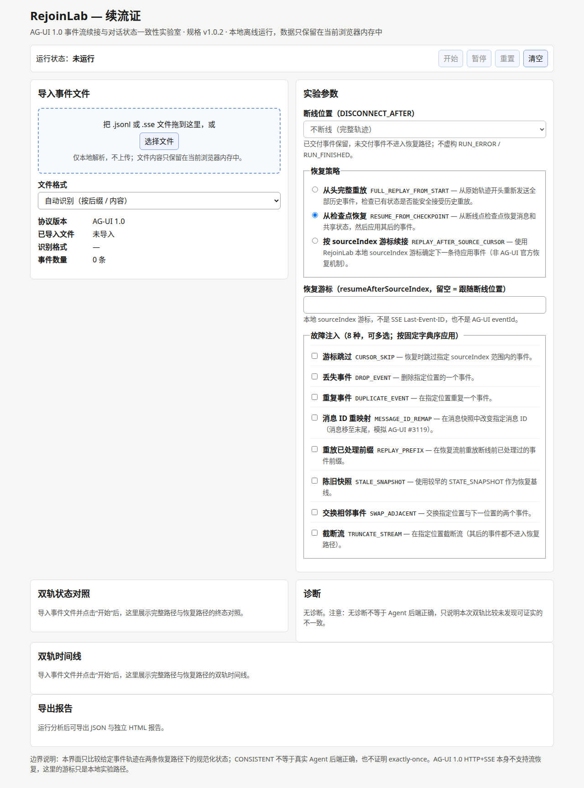
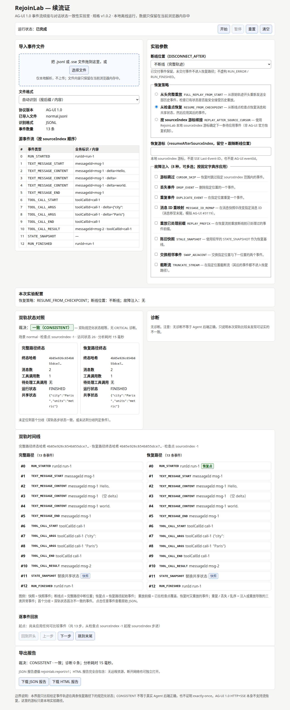
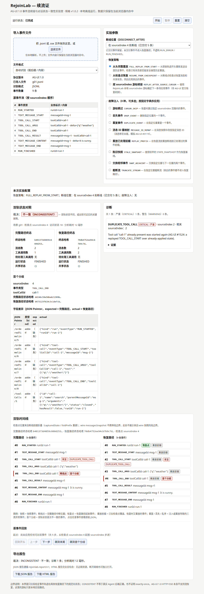

# RejoinLab — Your AI agent reconnected. Did your conversation survive correctly?

RejoinLab（续流证，P031）是一个本地运行的 AG-UI 事件流续接与对话状态一致性实验室。
你导入一条 AI Agent 事件流后，它自动构造断线、重连、重放、快照恢复等场景，
比较**完整事件流**和**恢复事件流**所产生的对话状态，定位：哪条工具调用被重复；
哪段文本被遗漏；哪段回答被移动到工具调用之前或之后；哪个消息被错误地合并或拆分；
哪次状态快照覆盖了较新的状态；哪些事件在恢复后被重复应用；哪个恢复路径无法重建原有对话状态。

它只做一件事：**核验事件经过断线、恢复和重放后，是否仍能得到与完整事件流一致的用户可见状态。**
它不判断模型回答是否正确，不判断工具执行是否合理，也不推测 Agent 后端内部发生了什么。

- 协议：AG-UI 1.0（2026-09-18 发布，冻结版本）。
- 运行方式：本地静态 Web 应用，离线运行，不上传文件，不连接真实 Agent，不请求外部模型。
- 数据：全部合成数据或用户主动导入的本地文件；真人参与 0 人。
- 许可证：MIT。

## 谁需要它

正在开发聊天式 AI Agent 应用的前端工程师 / 全栈工程师：Agent 通过 HTTP/SSE
流式传递事件，前端维护消息列表、工具调用卡片和 Agent 状态；网络中断后浏览器刷新恢复历史，
却发现工具调用卡片出现两次、工具结果出现在调用之前、助手回答的后半段跑到了工具调用之前。
RejoinLab 告诉你：究竟是哪一个事件、哪一个恢复位置或哪一种状态合并方式导致了差异。

真实故障依据（均已核对 AG-UI 仓库原文，见 `01_project_book/PROJECT_BOOK.md` §2.3）：

- AG-UI #1524：`TOOL_CALL_START` 处理不幂等，重放历史事件会重复插入工具调用（Golden G01）。
- AG-UI #3119：`MESSAGES_SNAPSHOT` 更换 assistant messageId 后，工具结果和回答留在调用之前（Golden G02）。
- AG-UI #3368：同一 messageId 的文本消息在工具调用后重新打开，后半段文本显示在调用之前（Golden G03）。

## 快速开始

环境要求：Node.js ≥ 24，npm，Python 3.12+（仅独立 Oracle 需要）。

```bash
npm ci            # 安装依赖（唯一需要联网的步骤；产品运行时不联网）
npm run dev       # 开发服务器，默认 http://localhost:5173
npm run build     # 生产构建，产物在 dist/
npx vite preview --port 4173   # 预览构建产物
```

如果 `localhost` 在你的机器上解析异常（例如只解析到 IPv6 而服务只监听 IPv4），
用显式地址启动：`npx vite --port 5199 --host 127.0.0.1`。

打开页面后：导入 `.jsonl` 或 `.sse` 文件 → 选择断线位置 → 选择恢复策略 →
选择是否注入重复、丢失、乱序或快照故障 → 点击运行 → 在 Web Worker 中执行双轨归约 →
查看完整路径与恢复路径、首个状态分歧、诊断证据 → 导出 JSON 或独立 HTML 报告。

示例文件：`fixtures/golden/` 下有 24 条 Golden 合成轨迹（`rejoinlab.golden/v1`，
测试语料，用 `npm run test:oracle` 运行，不是直接导入 UI 的文件格式）。
要亲手导入一条事件流，见 `docs/USER_GUIDE.md` 的最小 JSONL 示例。

## 它检查什么

- **15 种 AG-UI 1.0 事件**：RUN_STARTED / RUN_FINISHED / RUN_ERROR、
  TEXT_MESSAGE_START / CONTENT / END / CHUNK、TOOL_CALL_START / ARGS / END / CHUNK /
  RESULT、STATE_SNAPSHOT、STATE_DELTA、MESSAGES_SNAPSHOT。
  不支持的事件（STEP_*、REASONING_*、ACTIVITY_*、SUBAGENT_*、RAW、CUSTOM、
  未列出的 draft 事件）不会被静默丢弃：报告 INCONCLUSIVE_LIMIT 或 INVALID_INPUT，
  并指出事件位置和类型。
- **5 种裁决**：CONSISTENT（一致）、INCONSISTENT（不一致）、INCONCLUSIVE_LIMIT（超出计算边界）、
  INVALID_INPUT（输入无效）、INCOMPLETE_TRACE（轨迹不完整）。
  CONSISTENT 不等于 Agent 后端正确；INCOMPLETE_TRACE 不得降级为 CONSISTENT。
- **10 种诊断代码**：DUPLICATE_TOOL_CALL、LOST_EVENT、OUT_OF_ORDER、MESSAGE_REORDER、
  SNAPSHOT_MISMATCH、DIVERGENT_STATE（以上 CRITICAL）；SUSPECTED_DUPLICATE、TOOL_CALL_ID_REUSE、
  TRUNCATED_RUN、MISSING_TERMINAL（以上 WARNING）。
- **8 种故障注入算子**：DUPLICATE_EVENT、DROP_EVENT、SWAP_ADJACENT、STALE_SNAPSHOT、
  REPLAY_PREFIX、MESSAGE_ID_REMAP、CURSOR_SKIP、TRUNCATE_STREAM。
- **3 种恢复策略**：FULL_REPLAY_FROM_START（从头完整重放）、RESUME_FROM_CHECKPOINT（从检查点恢复）、
  REPLAY_AFTER_SOURCE_CURSOR（按 sourceIndex 游标恢复）。

## 它如何工作：双轨比较

```
S_full   = fold(R, S_0, E)            完整事件流归约
S_resume = fold(R, S_k_snapshot, E_{k+1:n})   快照恢复 + 后续事件归约
一致  ⟺  canon(S_full) = canon(S_resume)
```

- `R` 是确定性参考 Reducer：`S_{i+1} = R(S_i, e_i)`，无随机数、无时间读取、无网络、不修改输入。
- `canon` 是 RFC 8785 JSON Canonicalization Scheme 语义的规范化序列化（对象键排序、数组顺序保留、
  排除 timestamp / sourceIndex 等非业务字段），结果取 UTF-8 字节的 SHA-256。
- 生产 TypeScript 实现与 Python Oracle 各自独立实现 Reducer、canon、故障注入和诊断分类，
  不共享核心状态计算代码；两者逐轨迹字段级比较（parity）。
- 不一致时定位**首个分歧**：按 sourceIndex 对齐两条路径，逐事件步进规范化状态，
  输出第一个状态不相等的位置、差异 JSON Pointer 与相关业务 ID。
- 最短故障序列用确定性 BFS：固定算子顺序、固定字典序
  （CURSOR_SKIP、DROP_EVENT、DUPLICATE_EVENT、MESSAGE_ID_REMAP、REPLAY_PREFIX、
  STALE_SNAPSHOT、SWAP_ADJACENT、TRUNCATE_STREAM），首次找到的分歧即最少注入步数。
- **SSE 与恢复游标的区别**：AG-UI 1.0 的标准 HTTP+SSE 绑定**不支持流恢复**——消费者忽略 SSE 的
  id / event / retry 字段；连接中断且没有收到终止事件时，该 run 是 truncated；重新运行是一个带
  新 runId 的新 run。WHATWG SSE 的 Last-Event-ID 只是传输层机制，不是 AG-UI 恢复游标。
  RejoinLab 解析 SSE 文件中的 id 字段并保留为传输层原始证据（`transportEventId`），
  不把它认定为 AG-UI 事件 ID 或官方恢复游标；恢复位置用本地 `sourceIndex` 与
  `resumeAfterSourceIndex` 游标模拟，不执行真实网络重连。
- **exactly-once 不在保证范围内**：RejoinLab 不提供 exactly-once 投递保证，
  不证明工具只会执行一次，也不证明真实网络传输没有丢包。

## 实测证据（S0 硬门禁已通过）

S0 = T001–T007，裁决 **PASS（13/13）**，证据见 `artifacts/reports/S0_GATE.json` 与
`artifacts/reports/S0_REPORT.md`（生成时间 2026-11-24T01:47:42.241Z，HEAD `44d59df`）：

| 指标 | 实测 | 门槛 |
|---|---|---|
| Golden 正确分类 | 24/24 | 24/24 |
| 已知故障检出（G01–G08） | 8/8 | 8/8 |
| 正常轨迹正确通过（N01–N16） | 16/16 | 16/16 |
| False Positive / False Negative | 0 / 0 | 0 / 0 |
| Python Oracle parity | 24/24 | 24/24 |
| 合法恢复收敛率 | 24/24（100%） | 100% |
| 确定性重复执行 | 2400 次，每条 Golden 恰 1 个报告哈希 | 100/100 每条 |
| 最大事件轨迹 | 40 条事件正常评估；41 条 → INCONCLUSIVE_LIMIT | 40 条 |
| 单轨迹性能 | 最慢 42.8 ms（T-40 analyze）；最慢 Golden G05 10.7 ms | < 1,000 ms |
| 搜索节点上限 | 最多 8 节点 | ≤ 5,000 |
| 离线运行外部请求 | 0 | 0 |
| 真人参与 | 0 | 0 |

配套套件（同一次 S0 运行）：typecheck 0 错；test:core 137/137；test:canonical 37/37；
test:replay 127/127；test:determinism 5/5；test:performance 7/7；Oracle pytest 177/177；
Oracle run_goldens 24/24；门禁测试 66/66。

T012 性能复测（`artifacts/logs/T012_PERFORMANCE.log`，2026-11-24T01:47:11.439Z 运行，
HEAD `44d59df`，40 事件轨迹 10 次重复）：evaluate 最大 20.88 ms，analyze 最大 76.86 ms；
24 条 Golden 最慢 G01 12.77 ms；BFS 最多 8 节点；
41 事件 10/10 返回 INCONCLUSIVE_LIMIT；
真实 Chromium Worker（5 次）：计算最大 42.00 ms，往返最大 105.80 ms。
各轮实测存在冷启动波动——同一命令在 S0 门禁运行中 analyze 最大 42.8 ms，
本次 T012 运行中最大 76.86 ms，两个值都远低于 1,000 ms 门槛；
因此这里引用的是带时间戳的当次运行实测最大值，不是单次最好成绩，
引用时必须与日志原文逐值核对（`npm run verify:docs` 会重算）。

确定性复测（`artifacts/logs/T012_DETERMINISM.log`）：每条 Golden 100 次重复，
报告 SHA-256 100 次完全相同（G01 `e59641cb…93d64a`、G03 `2eb66561…311ca9`、
N09 `b2a4f7b9…b8a3b5`）；最短故障序列、首个分歧、诊断代码顺序 100 次完全相同。

测试命令：`npx vitest run`（678/678，exit 0）或逐套件运行；Playwright E2E 用 `npm run test:e2e`。
注：vitest 曾因缺少配置文件而把 Playwright spec 也收进来、即使 600 个测试全过也退出 1，
已由 `vitest.config.ts`（排除 `tests/e2e/**`）修复，见 `docs/LIMITATIONS.md` L-T013-01。

```bash
npm run typecheck        # tsc --noEmit，0 错误
npm run test:core        # 137/137
npm run test:canonical   # 37/37
npm run test:replay      # 127/127
npm run test:parser      # 112/112
npm run test:report      # 89/89
npm run test:ui          # 50/50
npm run test:worker      # 70/70
npm run test:timeline    # 20/20
npm run test:determinism # 5/5 + 300 次脚本
npm run test:performance # 7/7 + 性能脚本
npm run test:privacy     # 隐私脚本
npm run test:security    # 安全脚本
npm run test:offline     # 离线脚本
npm run test:oracle      # Oracle run_goldens 24/24 + golden.test.ts
npm run test:e2e         # Playwright，12/12
npm run verify:s0        # S0 门禁，PASS
python3 -m pytest -q oracle/tests   # Oracle 自身测试，177/177
```

## 界面







截图来自 T011 浏览器 E2E（390/500/1280 三视口零溢出，标签横排可读）。

## 诚实边界：它能证明什么，不能证明什么

**能证明**（在给定的 AG-UI 1.0 事件子集、已导入事件序列、初始状态、快照语义、
恢复游标、有界事件轨迹、固定故障注入规则范围内）：完整事件流产生的状态；
恢复事件流产生的状态；两条路径的最终状态是否相等；是否存在消息顺序变化；
是否存在工具调用重复；是否存在已知事件丢失；是否存在状态快照差异；
最短故障注入序列；首个可定位的状态分歧；相同输入能否稳定产生相同报告。

**不能证明**：Agent 后端业务逻辑正确；Agent 模型生成内容正确；真实网络传输没有丢包；
真实服务端支持断点恢复；AG-UI SDK 实现没有其他缺陷；工具只会执行一次；
exactly-once 投递；真实浏览器和所有前端框架表现一致；
所有可能的分布式并发交错均被覆盖；超过 40 条事件的轨迹一定安全；
真实用户看到的 UI 与实验 Reducer 完全相同；用户实际节省了多少排查时间。

CONSISTENT 的正确解释：在本次给定事件轨迹、Reducer 规则、快照语义和有界恢复路径中，
两条计算路径得到相同的规范化状态。错误解释：这个 Agent 在所有真实网络故障下都不会丢消息或重复调用工具。
INCONCLUSIVE_LIMIT 的正确解释：搜索边界不足以支持一致性结论。错误解释：没有找到错误，所以安全。

已知偏差与遗留限制见 `docs/LIMITATIONS.md`（含 T010 的 null 路径偏差、
G06 显式陈旧检查点在 UI 上不可达等 31 项）。终审包必须逐项确认，不得静默接受。

## 文档地图

- `01_project_book/PROJECT_BOOK.md` — 冻结项目书 v1.0.2（§0–§18，权威规格）。
- `02_implementation_plan/IMPLEMENTATION_PLAN.md` — 冻结实施计划 v1.0.2（T001–T014）。
- `docs/USER_GUIDE.md` — 用户指南：导入、实验配置、读报告、示例、故障排查。
- `docs/ALGORITHM.md` — 核心算法：Reducer、双轨比较、canon、BFS、首分歧定位。
- `docs/MODEL_CONTRACT.md` — 模型契约：事件子集、标识符与游标、裁决与诊断、报告接口、冻结裁决。
- `docs/AGUI_SCOPE.md` — AG-UI 1.0 协议范围冻结（T001）。
- `docs/EVENT_SCHEMA.md` — 事件 Schema 与字段表（T001）。
- `docs/ADR-F01-pending-derived.md` — ADR：G05 pendingToolCallIds 为派生状态（T007 FIX）。
- `docs/LIMITATIONS.md` — 已知限制与偏差清单（31 项）。
- `THIRD_PARTY_NOTICES.md` — 第三方许可证清单（137 个包，100% 覆盖）。
- `SECURITY.md` — 安全说明与隐私承诺。
- `artifacts/reports/S0_REPORT.md` — S0 硬门禁核验报告。

## 许可证

自有代码 MIT，见 `LICENSE`。第三方依赖见 `THIRD_PARTY_NOTICES.md`。
